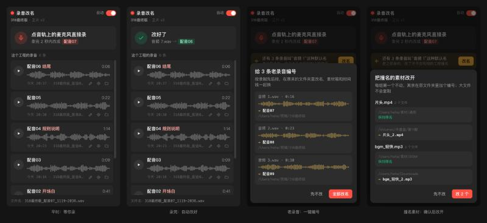

# 赫朝录音改名

Premiere 里点音轨上的麦克风录画外音，录出来的文件默认叫「音频 1.wav」「音频 2.wav」。换个工程、换个人接手，名字就撞在一起，打包或交接时互相覆盖、链错素材。

装上这个插件以后，**录完 2 秒内自动改成不会撞的名字**，文件、素材箱、时间线一起换：

| 地方 | 改成 |
|---|---|
| 磁盘上的文件 | `318最终版_配音07_1119-1530.wav`（工程名 + 编号 + 录制时间） |
| 素材箱、时间线上的片段 | `配音07` |
| 自己起名以后 | `318最终版_配音07_开场白_1119-1530.wav`，时间线上叫 `配音07 开场白` |



## 面板上能做什么

- **自动改名**：右上角开关，默认开着。PR 一启动就在后台工作，面板不用开。
- **录音列表**：这个工程录过的音，带波形、时长、录制时间；能直接试听。
- **起名**：点铅笔给某条录音起个名字（比如“开场白”），编号不变。
- **找到它**：在项目面板里选中、在访达 / 资源管理器里显示。
- **老录音**：装插件之前录的「音频 N」，面板会提示，一键按录制先后编好号。
- **撞名的素材**：不同文件夹里文件名一样的视频、音乐、图片，面板会提示，确认后在原文件夹里改成 `原名_2`（大文件不复制）。

## 安装

1. 退出 Premiere。
2. Mac：右键 `scripts/安装-macOS.command` → 打开。Windows：双击 `scripts/安装-Windows.bat`。
3. 重新打开 Premiere。想看面板：**窗口 → 扩展 → 赫朝录音改名**。

给别人装：`npm run package` 生成 `out/赫朝录音改名-<版本>.zip`，对方解压后双击里面的安装脚本，不用装 Node。

支持 Premiere Pro 2019（13.0）到 2026，Mac 和 Windows。

## 出了问题怎么办

- **不用描述**：面板底部有「复制问题报告」，出错时状态栏上也有。点一下，粘贴发过来就行，里面有插件版本、系统、Premiere 版本、工程路径和最近的日志。
- 日志文件：Mac `~/Library/Logs/赫朝录音改名/log.txt`，Windows `%APPDATA%\赫朝录音改名\log.txt`。
- **自动更新**：PR 开着时每 6 小时看一次有没有新版，有就自己下载、核对、换上，面板刷新一下就是新版，不用重装、不用重启 PR。新版只有在 Windows 和 Mac 上测试全过以后才会发出来。

## 安全

- 不覆盖任何已有文件：目标名字被占了就加 `_2`。
- 先放好新文件、让 Premiere 换过去并核对成功，才删旧文件；Premiere 换不过去就把新文件收回、旧文件不动。
- 同一块盘用硬链接（瞬间完成）；不支持硬链接的盘（exFAT、网络盘）复制一份并核对内容一致。
- Windows 上 Premiere 还占着旧文件时，过一会儿再删，工程里还有素材在用就不删。
- 工程没保存时什么都不改。

## 开发

```bash
npm ci            # 装模拟环境用的 Electron
npm test          # 命名规则、波形、整条链路（真正的 host.jsx 跑在假 Premiere 里，读写真文件）、自动更新
npm run sim       # 模拟环境：在 Electron 里打开真正的面板，接假 Premiere 工程走一遍，每步截图到 out/sim/
npm run preview   # 不开 PR 看面板：http://127.0.0.1:4180/?state=ready ，四种状态并排：/preview/overview.html
npm run package   # 打安装包
```

预览的 `state` 可选：`ready` `empty` `waiting` `working` `done` `error` `unsaved` `paused` `old` `dup` `connecting`。

### 没有 Windows 电脑也能测

每次推送，GitHub 会在一台 Windows 和一台 Mac 上：跑全部测试（Windows 上还专门测 Premiere 占着文件删不掉的情况）、跑模拟环境并截图、用安装脚本真装一遍。截图在这次运行的「Artifacts」里（模拟截图-Windows / 模拟截图-macOS）。main 上两边都通过，才发布到 `release` 分支，装了插件的电脑从那里自动更新。

模拟环境模拟的是 Premiere 外面那层（CEP：Chromium + Node），Premiere 本身是假的（`tests/helpers/fake-premiere.js`）。它能抓到“面板起不来”“按钮没反应”“文件改坏了”这类问题，抓不到 Premiere 自己接口的怪脾气，那部分还得靠问题报告。

| 文件 | 干嘛的 |
|---|---|
| `extension/com.hechao.voiceover-namer/jsx/host.jsx` | Premiere 这头：报工程状态、列素材、换文件改名 |
| `js/engine.js` | 盯新录音、改名、老录音、撞名素材 |
| `js/core.js` | 命名规则、查重（纯函数） |
| `js/wave.js` | 读 WAV 时长和波形 |
| `js/ui.js` `css/panel.css` | 面板 |
| `js/updater.js` | 自动更新 |
| `js/log.js` | 日志和问题报告 |
| `sim/` | 模拟环境 |

## 为什么从 1.0 重写

0.x 用的是 Adobe 新出的 UXP 插件方式，要 Premiere 25.6 以上才认，剪辑用的 PR 2025（25.0）根本加载不了；代码也堆到七千多行，从没在真 PR 里录通过。1.0 换成 PR 2019 起都支持的 CEP 扩展，和 Claude PR 桥同一种方式，只留真正要用的功能。

## 待实机确认

1.0.0 在没有 Premiere 的 Mac 上写的，下面这些要在真 PR 里录一条确认：

- 原生画外音录完后，素材出现在项目里、文件写完（插件看到文件 1.5 秒不再变化才动手；参数 `STABLE_MS`，在 `js/engine.js`）。
- `changeMediaPath` 换过去以后素材不离线、时间线片段名跟着变成「配音NN」。
- 面板关着时后台也在改名（manifest 里 `StartOn` 跟着 PR 启动）。
- Windows：Premiere 占着旧文件时，旧文件过一会儿自动删掉。
